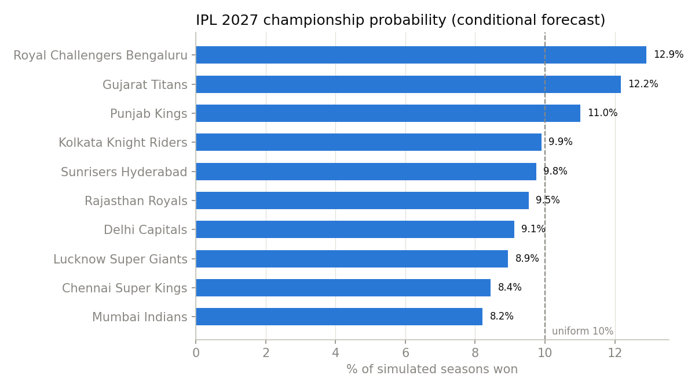
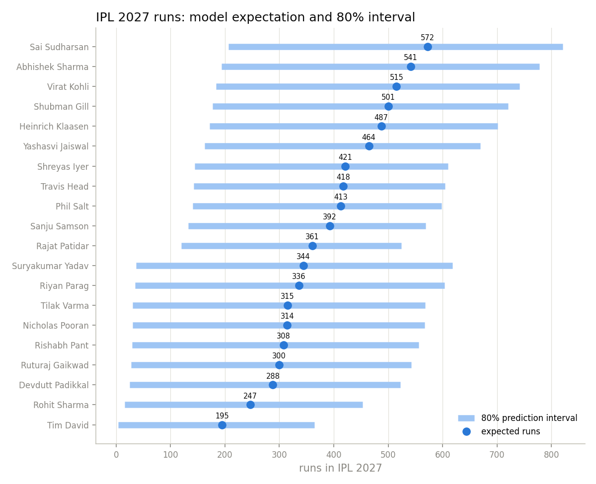
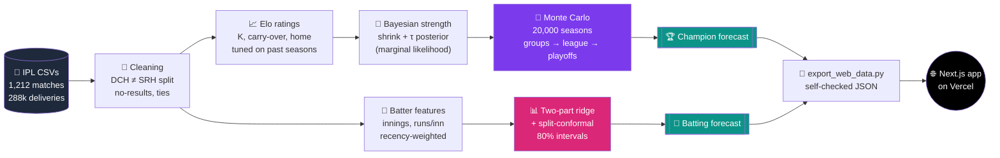
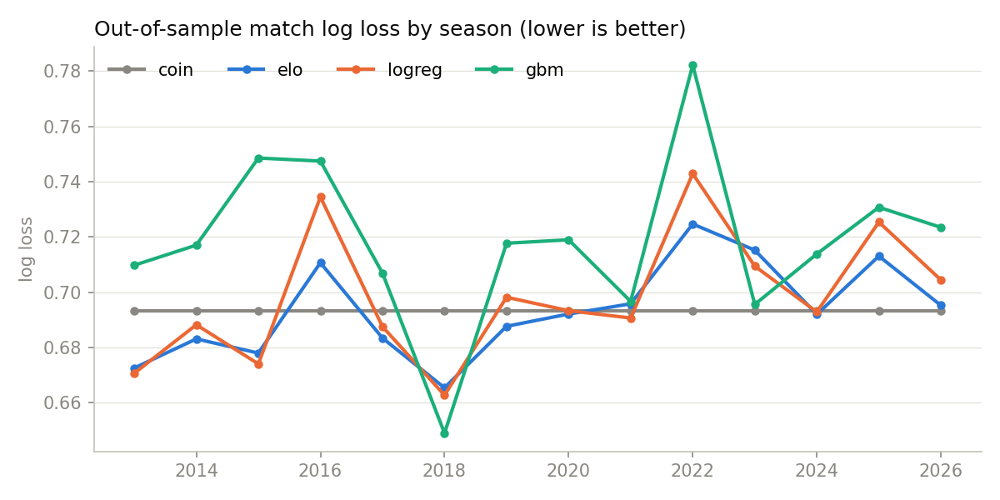
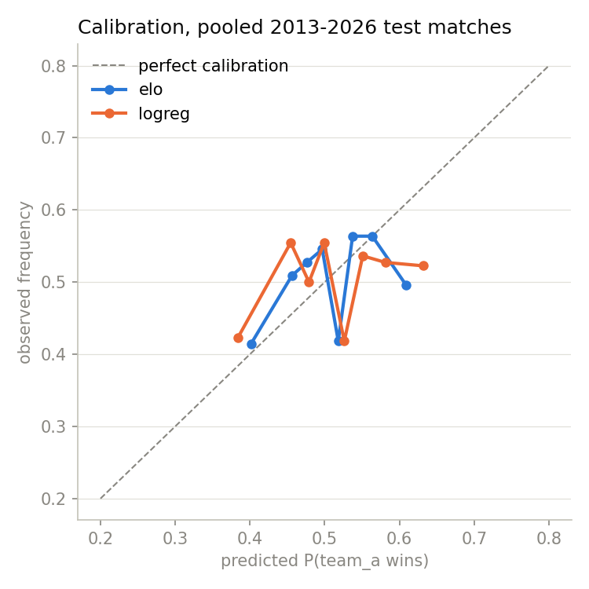

<div align="center">

# 🏏 IPL 2027 Forecast Lab

**Who wins IPL 2027, and how many runs will the stars score?**
<br/>
A season-by-season backtested machine-learning pipeline, plus an interactive web app where you can re-run the simulation yourself.

<br/>

[](https://ipl-prediction-beryl.vercel.app)


<br/>


</div>

---

## 📑 Contents

- [✨ Highlights](#-highlights)
- [🏆 The 2027 champion forecast](#-the-2027-champion-forecast)
- [🏏 The 2027 batting forecast](#-the-2027-batting-forecast)
- [🧠 How it works](#-how-it-works)
- [🔬 How honest are the numbers?](#-how-honest-are-the-numbers)
- [🌐 The web app](#-the-web-app)
- [🚀 Quick start](#-quick-start)
- [🗂️ Project layout](#️-project-layout)
- [⚠️ Limitations](#️-limitations)
- [📬 Contact](#-contact)

---

## ✨ Highlights

| | |
|---|---|
| 🎯 **Two forecasts** | Title, final and top-four probabilities for all 10 franchises, and expected 2027 runs for 20 batters, each with an 80% interval |
| 🧪 **Backtested, no leakage** | Every model is tested season by season, trained only on earlier seasons, and compared against coin-flip and career-win-rate baselines |
| 🎲 **Monte Carlo seasons** | 20,000 simulated seasons, each with randomly drawn groups, team strengths sampled from a fitted Bayesian posterior, and full playoffs |
| 📏 **Calibrated intervals** | Batter ranges use split-conformal calibration; in the backtest, 80.1% of actual totals landed inside the 80% interval |
| 🕹️ **Simulation Lab** | Change team strengths, uncertainty, home advantage, or a batter's playing time and form, then re-run the real simulator in the browser |
| 🙅 **Honest by design** | Where the models are no better than chance, the site says so |

---

## 🏆 The 2027 champion forecast

> [!IMPORTANT]
> **This is a wide-open field.** The favourite's title chance is 12.9%, only slightly above the 10% you'd get by picking a team at random. Every team is more likely **not** to win.

| # | Team | 🏆 Champion | 🥈 Final | 🔝 Top four | Exp. points | Elo (end of data) |
|:-:|---|:-:|:-:|:-:|:-:|:-:|
| 1 | 🔴 Royal Challengers Bengaluru | **12.9%** | 24.5% | 45.9% | 14.5 | 1516 |
| 2 | 🔵 Gujarat Titans | **12.2%** | 24.4% | 46.0% | 14.5 | 1513 |
| 3 | 🔴 Punjab Kings | **11.0%** | 21.5% | 42.5% | 14.2 | 1507 |
| 4 | 🟣 Kolkata Knight Riders | **9.9%** | 18.9% | 38.2% | 13.9 | 1496 |
| 5 | 🟠 Sunrisers Hyderabad | **9.8%** | 19.4% | 39.3% | 13.9 | 1500 |
| 6 | 🩷 Rajasthan Royals | **9.5%** | 19.8% | 39.7% | 14.0 | 1499 |
| 7 | 🔵 Delhi Capitals | **9.1%** | 18.5% | 38.4% | 13.8 | 1496 |
| 8 | 🩵 Lucknow Super Giants | **8.9%** | 18.4% | 38.0% | 13.8 | 1495 |
| 9 | 🟡 Chennai Super Kings | **8.4%** | 17.8% | 36.8% | 13.7 | 1493 |
| 10 | 🔵 Mumbai Indians | **8.2%** | 16.8% | 35.3% | 13.6 | 1492 |

<p align="center">
  
</p>

📄 Full write-up: [REPORT.md](REPORT.md) · full tables: [outputs/results.md](outputs/results.md)

---

## 🏏 The 2027 batting forecast

A separate analysis of 20 shortlisted batters. Expected runs = **expected innings × runs per innings**. Expected innings come from each batter's own history of missed matches and seasons, so the model does **not** assume everyone plays every game.

| # | Batter | Exp. runs | 80% interval | Innings | Average | Strike rate | Confidence |
|:-:|---|:-:|:-:|:-:|:-:|:-:|:-:|
| 🥇 | Sai Sudharsan | **572** | 207–820 | 14.3 | 42.7 | 153.3 | 🟢 High |
| 🥈 | Abhishek Sharma | **541** | 194–777 | 14.7 | 39.6 | 200.9 | 🟢 High |
| 🥉 | Virat Kohli | **515** | 183–741 | 13.5 | 48.2 | 153.1 | 🟢 High |
| 4 | Shubman Gill | **501** | 177–720 | 13.1 | 42.1 | 153.4 | 🟢 High |
| 5 | Heinrich Klaasen | **487** | 172–702 | 14.7 | 41.2 | 165.6 | 🟢 High |
| 6 | Yashasvi Jaiswal | **464** | 162–670 | 13.1 | 40.3 | 158.1 | 🟢 High |
| 7 | Shreyas Iyer | **421** | 145–610 | 13.3 | 45.5 | 167.4 | 🟢 High |
| 8 | Travis Head | **418** | 143–604 | 12.7 | 34.1 | 171.9 | 🟢 High |
| 9 | Phil Salt | **413** | 141–598 | 11.5 | 38.7 | 174.7 | 🟡 Medium |
| 10 | Sanju Samson | **392** | 133–569 | 11.8 | 42.6 | 154.5 | 🟡 Medium |

<sub>All 20 batters, scenarios (full season, strong or weak form, reduced role) and 2024–26 splits: [reports/ipl_2027_batting_predictions.md](reports/ipl_2027_batting_predictions.md)</sub>

<p align="center">
  
</p>

> [!TIP]
> Even "High" confidence carries an interval several hundred runs wide. Playing time, form and role are genuinely uncertain, and the intervals are sized to match how wrong past forecasts actually were.

---

## 🧠 How it works



### 🏆 Champion model

1. **Elo ratings** are updated after every match. K = 4, home advantage = 20 Elo, and ratings are pulled 20% back toward 1500 between seasons. All three are tuned on past seasons only.
2. **2027 starting strength** for each team is `1500 + shrink × (Elo − 1500) + Normal(0, τ²)`. `shrink` and `τ` aren't fixed: they're fitted by the Monte Carlo **marginal likelihood** of every past season's actual outcome, and the forecast **averages over the whole posterior**.
3. **Each simulated season** draws team strengths, draws the two groups at random (2022–26 format), plays 70 league matches, breaks ties with a net-run-rate proxy, then plays Qualifier 1, Eliminator, Qualifier 2 and the Final.
4. **Probabilities** are frequencies over 20,000 seasons, with a Monte Carlo standard error of ≈ 0.24 percentage points.

### 🏏 Batting model

| Step | Model |
|---|---|
| 🧍 **Innings** | Ridge regression on each batter's recent share of team matches, including seasons they missed |
| 🏃 **Runs per innings** | Ridge regression on recency-weighted, shrunk career and recent form |
| ✖️ **Total** | Innings × runs per innings |
| 📏 **Interval** | Split-conformal bands from 2014–2025 out-of-sample errors, calibrated separately for low, mid and high forecasts |

### 🛡️ Leakage controls

- ⏪ **Rolling origin:** to forecast season *S*, every parameter is fitted on seasons up to *S − 1*.
- 🔒 **Features** use `shift(1)`. A unit test checks that changing a match's own result can't change its features.
- 🪙 **No toss, no playing XIs** in the main models. Toss appears only in one clearly labelled post-toss variant.
- 🔤 **`team1` is post-toss information** (it bats first 75% of the time), so teams are ordered alphabetically instead.

---

## 🔬 How honest are the numbers?

> [!WARNING]
> **IPL matches are close to coin flips, and no model here beats one by a meaningful margin.** The site and reports say this up front instead of hiding it.

<table>
<tr>
<td width="50%" valign="top">

**🎯 Match level** (882 matches, 2013–2026, out of sample)

| Model | Log loss ↓ | Brier ↓ |
|---|:-:|:-:|
| 🪙 Coin flip | **0.6931** | **0.2500** |
| 📈 **Elo** | 0.6942 | 0.2505 |
| 📊 Win % (log5) | 0.6966 | 0.2516 |
| 🧮 Logistic regression | 0.6988 | 0.2527 |
| 🌲 Gradient boosting | 0.7188 | 0.2622 |

Elo − coin: +0.0010, 95% interval [−0.0069, +0.0098], so **no detectable difference**.

</td>
<td width="50%" valign="top">

**🏆 Pre-season title forecasts** (scored on the actual champion)

| Period | Beat a uniform guess |
|---|:-:|
| 2013–2021 | 🟢 7 of 9 |
| 2022–2025 | 🔴 1 of 4 |
| **All** | **8 of 13** |

Before 2022, CSK and MI stayed strong for years. Since the 2022 expansion and mega-auctions, the champions were ranked #5, #1, #9 and #10 pre-season.

**🏏 Batting:** typical error 136.6 runs for established batters; 80% intervals contained **80.1%** of actual totals.

</td>
</tr>
</table>

<p align="center">
  
  
</p>

---

## 🌐 The web app

**👉 [ipl-prediction-beryl.vercel.app](https://ipl-prediction-beryl.vercel.app)**

| Page | What you can do |
|---|---|
| 🏠 **Home** | Headline numbers and the three ways in |
| 🏆 **[Champion](https://ipl-prediction-beryl.vercel.app/champion)** | Switch between champion, final and top four; open any team's Elo history, record and the factors behind its number |
| 🏏 **[Batters](https://ipl-prediction-beryl.vercel.app/batters)** | Search, sort and filter 20 batters; open a profile for each; compare 2–4 side by side |
| 🕹️ **[Simulation Lab](https://ipl-prediction-beryl.vercel.app/simulator)** | Move team-strength sliders, set uncertainty and home advantage, run 1k–10k seasons; or change a batter's matches, availability and form |
| 📚 **[Methodology](https://ipl-prediction-beryl.vercel.app/methodology)** | Data coverage, models, validation tables and limitations |
| 📄 **Reports** | Both pipeline reports rendered in full, with CSV and Markdown downloads |

**Under the hood:**
- ⚡ The simulator is **ported from Python to TypeScript** and runs in a Vercel serverless function (5,000 seasons in about 70–300 ms). A unit test checks it reproduces the Python probabilities for all 10 teams within Monte Carlo error.
- 🛡️ Input is validated server-side, runs are capped, and the site sends a strict Content-Security-Policy.
- 🌗 Light and dark themes, a responsive layout down to 320 px, and hand-built SVG charts with no chart library.
- 💸 No database, no login, no paid services.

More detail: [web/README.md](web/README.md)

---

## 🚀 Quick start

<details open>
<summary><b>🐍 Run the models</b> (Python 3.10+)</summary>

```bash
pip install -r requirements.txt
python run.py               # 🏆 champion pipeline, ~20 s → outputs/   (--sims N to change simulations)
python run_batting.py       # 🏏 batting pipeline → reports/
python -m pytest -q tests   # ✅ 14 tests
```

</details>

<details open>
<summary><b>🌐 Run the web app</b> (Node 20+)</summary>

```bash
python export_web_data.py   # 🔄 publish model outputs to web/ (fails loudly if numbers don't match)
cd web
npm install
npm run dev                 # 👉 http://localhost:3000
npm test                    # ✅ 17 tests
```

</details>

<details>
<summary><b>☁️ Deploy</b></summary>

The repo is connected to Vercel (root directory `web`). **Every push to `main` deploys to production automatically.** No secrets are required; `NEXT_PUBLIC_SITE_URL` and `SIM_MAX_RUNS` are optional (see `web/.env.example`).

</details>

---

## 🗂️ Project layout

```text
📦 IPL-Prediction
├── 📂 IPL/                    raw data (provided CSVs, unchanged)
├── 🏆 iplpred/                champion pipeline
│   ├── data.py               loading, team canonicalisation, playoffs and champions
│   ├── features.py           Elo + leak-free rolling features
│   ├── models.py             baselines, LR, GBM, backtests, Bayesian strength model
│   └── simulate.py           vectorised season simulator + group-format fixtures
├── 🏏 batting/                batting pipeline (data, model, report)
├── ✅ tests/                  Elo maths, leakage guard, fixtures, symmetry, batting
├── 📊 outputs/                champion artifacts, plots, results.md
├── 📄 reports/                batting report, CSV and plots
├── 🌐 web/                    Next.js 15 app (pages, API routes, TS simulator)
├── ▶️ run.py · run_batting.py · export_web_data.py
└── 📝 REPORT.md
```

> [!NOTE]
> The package is called `iplpred`, not `ipl`, because macOS's case-insensitive filesystem would merge an `ipl/` folder with the `IPL/` data folder.

To change the 2027 assumptions (teams, format, number of simulations, τ grid), edit `forecast_2027` in `run.py` and the grids at the top of `iplpred/models.py`.

---

## ⚠️ Limitations

> [!CAUTION]
> These are **model estimates, not predictions of a guaranteed result, and not betting advice.**

- 📅 **Data stops on 2026-05-01**, 43 matches into the 2026 season. Later 2026 results and the 2026 champion are not used.
- 👥 **No 2027 squads, auction, retentions, injuries, schedule or groups** exist in the data. The forecast assumes the 2026 franchises and the 2022–26 format.
- 🔁 Batters are shown with their **2026 team**; 2027 teams aren't confirmed.
- 🧹 Data quirks are documented and fixed in [REPORT.md §1](REPORT.md): Deccan Chargers vs SRH, fake winners on no-results, missing abandoned matches, and venue spellings.

---

## 📬 Contact

For technical enquiries about the software, the machine-learning pipeline, deployment or collaboration:

**✉️ aakif9866@gmail.com** · **🐙 [@Aakif9866](https://github.com/Aakif9866)**

<div align="center">
<sub>Not affiliated with the IPL, BCCI or any franchise. Team names are used descriptively; no logos or player photographs are used.</sub>
</div>
