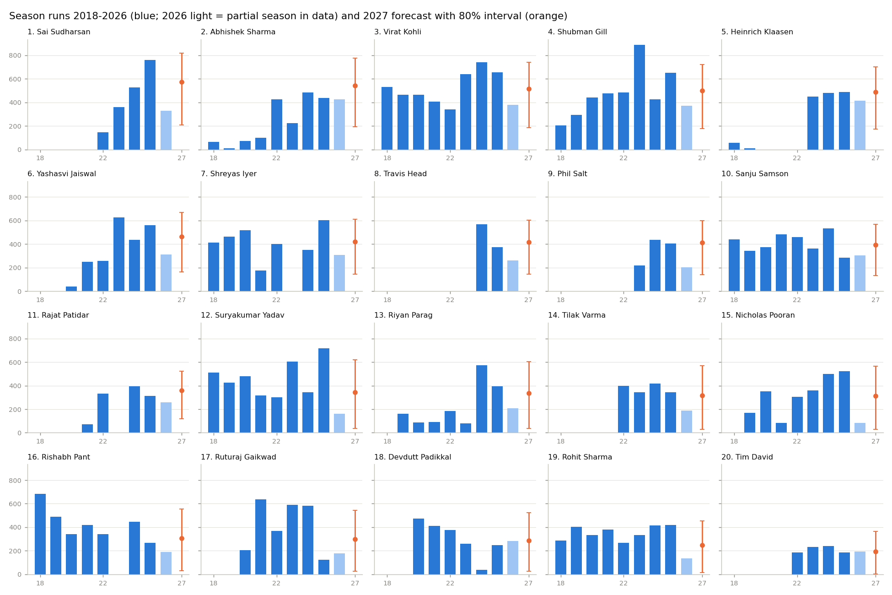
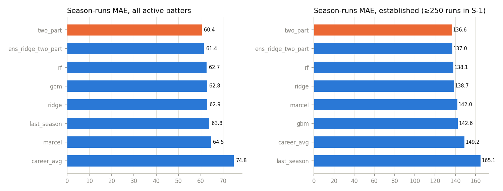

# IPL 2027 batting predictions — 20 shortlisted batters

*A separate analysis from the IPL 2027 champion forecast; it shares only the raw data files. Generated by `python run_batting.py`. Data cutoff: last match in the data (IPL 2026 is partial: 43 matches).*

**These are model estimates, not facts.** No 2027 squads, teams, batting orders, fitness or schedule exist in the data. Expected innings come from each player's own history of playing time (including missed seasons), so the forecast does **not** assume every player plays the full tournament.

## A. Main predictions

| Rank | Batter | Expected Runs | Lower Estimate | Upper Estimate | Expected Innings | Expected Average | Expected Strike Rate | Confidence |
|---:|---|---:|---:|---:|---:|---:|---:|---|
| 1 | Sai Sudharsan | 572 | 207 | 820 | 14.3 | 42.7 | 153.3 | High |
| 2 | Abhishek Sharma | 541 | 194 | 777 | 14.7 | 39.6 | 200.9 | High |
| 3 | Virat Kohli | 515 | 183 | 741 | 13.5 | 48.2 | 153.1 | High |
| 4 | Shubman Gill | 501 | 177 | 720 | 13.1 | 42.1 | 153.4 | High |
| 5 | Heinrich Klaasen | 487 | 172 | 702 | 14.7 | 41.2 | 165.6 | High |
| 6 | Yashasvi Jaiswal | 464 | 162 | 670 | 13.1 | 40.3 | 158.1 | High |
| 7 | Shreyas Iyer | 421 | 145 | 610 | 13.3 | 45.5 | 167.4 | High |
| 8 | Travis Head | 418 | 143 | 604 | 12.7 | 34.1 | 171.9 | High |
| 9 | Phil Salt | 413 | 141 | 598 | 11.5 | 38.7 | 174.7 | Medium |
| 10 | Sanju Samson | 392 | 133 | 569 | 11.8 | 42.6 | 154.5 | Medium |
| 11 | Rajat Patidar | 361 | 120 | 524 | 12.4 | 31.5 | 169.8 | High |
| 12 | Suryakumar Yadav | 344 | 37 | 618 | 11.8 | 35.1 | 161.9 | High |
| 13 | Riyan Parag | 336 | 35 | 603 | 12.1 | 32.8 | 153.2 | High |
| 14 | Tilak Varma | 315 | 31 | 568 | 11.9 | 32.0 | 149.1 | High |
| 15 | Nicholas Pooran | 314 | 31 | 567 | 11.6 | 33.5 | 165.1 | High |
| 16 | Rishabh Pant | 308 | 29 | 556 | 11.3 | 32.2 | 139.0 | High |
| 17 | Ruturaj Gaikwad | 300 | 27 | 543 | 9.7 | 36.3 | 136.0 | Medium |
| 18 | Devdutt Padikkal | 288 | 25 | 523 | 10.3 | 31.0 | 159.5 | Low |
| 19 | Rohit Sharma | 247 | 16 | 453 | 8.2 | 34.0 | 151.8 | Medium |
| 20 | Tim David | 195 | 4 | 364 | 10.3 | 38.2 | 176.8 | Medium |

Lower/Upper = 80% prediction interval for total runs (split-conformal around the point estimate, calibrated on 2014–2025 out-of-sample errors; see C). Expected average = expected runs ÷ expected dismissals; expected strike rate = recency-weighted, shrunk SR. Confidence: **High** = regular (batted in ≥70% of team matches) in each of the last 3 seasons, **Medium** = 2 of 3, **Low** = otherwise. Confidence is relative: even High carries an interval of several hundred runs.

Intervals are calibrated separately for predictions below 150, 150–350 and above 350 runs, so they jump at those boundaries (e.g. 361 → lower bound 120 vs 344 → 37): the 150–350 band historically contains many players who lost their place, so its downside is larger.

### Scenarios (runs)

Same runs-per-innings estimate under fixed playing time; strong/weak form = 90th/10th percentile of the historical ratio of actual to predicted runs per innings for established batters (×1.42 / ×0.62).

| Batter | Model expectation | Full season (14 inn) | Full + strong form | Full + weak form | Reduced (8 inn) |
|---|---:|---:|---:|---:|---:|
| Sai Sudharsan | 572 | 561 | 794 | 349 | 320 |
| Abhishek Sharma | 541 | 517 | 733 | 322 | 296 |
| Virat Kohli | 515 | 535 | 757 | 333 | 305 |
| Shubman Gill | 501 | 535 | 758 | 333 | 306 |
| Heinrich Klaasen | 487 | 466 | 659 | 290 | 266 |
| Yashasvi Jaiswal | 464 | 496 | 703 | 309 | 284 |
| Shreyas Iyer | 421 | 443 | 627 | 276 | 253 |
| Travis Head | 418 | 461 | 653 | 287 | 263 |
| Phil Salt | 413 | 503 | 712 | 313 | 287 |
| Sanju Samson | 392 | 467 | 662 | 291 | 267 |
| Rajat Patidar | 361 | 407 | 576 | 253 | 232 |
| Suryakumar Yadav | 344 | 407 | 576 | 253 | 233 |
| Riyan Parag | 336 | 389 | 551 | 242 | 222 |
| Tilak Varma | 315 | 371 | 525 | 231 | 212 |
| Nicholas Pooran | 314 | 379 | 537 | 236 | 217 |
| Rishabh Pant | 308 | 383 | 542 | 238 | 219 |
| Ruturaj Gaikwad | 300 | 434 | 615 | 271 | 248 |
| Devdutt Padikkal | 288 | 390 | 553 | 243 | 223 |
| Rohit Sharma | 247 | 424 | 600 | 264 | 242 |
| Tim David | 195 | 264 | 373 | 164 | 151 |

## B. Individual player analysis

Splits are for 2024–2026; benchmark = all batters at positions 1–4 in those seasons (SR: pace 160, spin 151, powerplay 153, middle 154, death 190). Strengths/risks are produced by fixed rules (±15 SR points with ≥60 balls, missed seasons, CV > 0.3, low recent share, role).

### 1. Sai Sudharsan (`B Sai Sudharsan`)
- **Historical trend:** 2022: 145 (5 inn), 2023: 362 (8 inn), 2024: 527 (12 inn), 2025: 759 (15 inn), 2026: 328 (9 inn). Teams in data: GT.
- **Recent performance:** 2026 (partial, to data cutoff): 328 runs in 9 innings, SR 162; last 10 innings: 408 runs, SR 163.
- **Strengths (data-derived):** strike rate 207 vs death (top-order benchmark 190, 61 balls); high recent runs per innings (weighted, shrunk: 42.8); frequent 50+ scores (35% of innings, weighted).
- **Risk factors:** none flagged by the rules beyond general IPL variance.
- **2027 estimate:** 572 runs (80% interval 207–820) from 14.3 expected innings × 40.1 runs/innings; confidence **High**.
- **Scenarios:** full season (14 inn) 561; strong form 794; weak form 349; reduced time (8 inn) 320.
- **Assumptions:** plays IPL 2027 with availability in line with the player's own recent history; role similar to 2024–2026; 2027 team, squad and batting position not known from the data.

### 2. Abhishek Sharma (`Abhishek Sharma`)
- **Historical trend:** 2020: 71 (7 inn), 2021: 98 (7 inn), 2022: 426 (14 inn), 2023: 226 (11 inn), 2024: 484 (16 inn), 2025: 439 (13 inn), 2026: 425 (9 inn). Teams in data: DC → SRH.
- **Recent performance:** 2026 (partial, to data cutoff): 425 runs in 9 innings, SR 209; last 10 innings: 457 runs, SR 209.
- **Strengths (data-derived):** strike rate 185 vs pace (top-order benchmark 160, 466 balls); strike rate 241 vs spin (top-order benchmark 151, 201 balls); strike rate 200 vs powerplay (top-order benchmark 153, 437 balls); strike rate 214 vs middle (top-order benchmark 154, 206 balls); high recent runs per innings (weighted, shrunk: 35.7); frequent 50+ scores (27% of innings, weighted).
- **Risk factors:** none flagged by the rules beyond general IPL variance.
- **2027 estimate:** 541 runs (80% interval 194–777) from 14.7 expected innings × 37.0 runs/innings; confidence **High**.
- **Scenarios:** full season (14 inn) 517; strong form 733; weak form 322; reduced time (8 inn) 296.
- **Assumptions:** plays IPL 2027 with availability in line with the player's own recent history; role similar to 2024–2026; 2027 team, squad and batting position not known from the data.

### 3. Virat Kohli (`V Kohli`)
- **Historical trend:** 2020: 466 (15 inn), 2021: 405 (15 inn), 2022: 341 (16 inn), 2023: 639 (14 inn), 2024: 741 (15 inn), 2025: 657 (15 inn), 2026: 379 (9 inn). Teams in data: RCB.
- **Recent performance:** 2026 (partial, to data cutoff): 379 runs in 9 innings, SR 166; last 10 innings: 422 runs, SR 160.
- **Strengths (data-derived):** high recent runs per innings (weighted, shrunk: 43.4); frequent 50+ scores (41% of innings, weighted).
- **Risk factors:** strike rate 134 vs spin (benchmark 151, 464 balls); strike rate 137 vs middle (benchmark 154, 518 balls); volatile season-to-season output (runs-per-innings CV 0.36 over 18 seasons).
- **2027 estimate:** 515 runs (80% interval 183–741) from 13.5 expected innings × 38.2 runs/innings; confidence **High**.
- **Scenarios:** full season (14 inn) 535; strong form 757; weak form 333; reduced time (8 inn) 305.
- **Assumptions:** plays IPL 2027 with availability in line with the player's own recent history; role similar to 2024–2026; 2027 team, squad and batting position not known from the data.

### 4. Shubman Gill (`Shubman Gill`)
- **Historical trend:** 2020: 440 (14 inn), 2021: 478 (17 inn), 2022: 483 (16 inn), 2023: 890 (17 inn), 2024: 426 (12 inn), 2025: 650 (15 inn), 2026: 373 (8 inn). Teams in data: KKR → GT.
- **Recent performance:** 2026 (partial, to data cutoff): 373 runs in 8 innings, SR 155; last 10 innings: 387 runs, SR 154.
- **Strengths (data-derived):** high recent runs per innings (weighted, shrunk: 40.7); frequent 50+ scores (34% of innings, weighted).
- **Risk factors:** volatile season-to-season output (runs-per-innings CV 0.33 over 8 seasons).
- **2027 estimate:** 501 runs (80% interval 177–720) from 13.1 expected innings × 38.2 runs/innings; confidence **High**.
- **Scenarios:** full season (14 inn) 535; strong form 758; weak form 333; reduced time (8 inn) 306.
- **Assumptions:** plays IPL 2027 with availability in line with the player's own recent history; role similar to 2024–2026; 2027 team, squad and batting position not known from the data.

### 5. Heinrich Klaasen (`H Klaasen`)
- **Historical trend:** 2023: 448 (11 inn), 2024: 479 (15 inn), 2025: 487 (13 inn), 2026: 414 (9 inn). Teams in data: RR → RCB → SRH.
- **Recent performance:** 2026 (partial, to data cutoff): 414 runs in 9 innings, SR 157; last 10 innings: 519 runs, SR 172.
- **Strengths (data-derived):** strike rate 176 vs spin (top-order benchmark 151, 346 balls); high recent runs per innings (weighted, shrunk: 37.2); frequent 50+ scores (27% of innings, weighted).
- **Risk factors:** no IPL innings in 2020, 2021, 2022 (availability/selection history); middle/lower-order role (weighted batting position 4.6) caps balls per innings.
- **2027 estimate:** 487 runs (80% interval 172–702) from 14.7 expected innings × 33.3 runs/innings; confidence **High**.
- **Scenarios:** full season (14 inn) 466; strong form 659; weak form 290; reduced time (8 inn) 266.
- **Assumptions:** plays IPL 2027 with availability in line with the player's own recent history; role similar to 2024–2026; 2027 team, squad and batting position not known from the data.

### 6. Yashasvi Jaiswal (`YBK Jaiswal`)
- **Historical trend:** 2020: 40 (3 inn), 2021: 249 (10 inn), 2022: 258 (10 inn), 2023: 625 (14 inn), 2024: 435 (15 inn), 2025: 559 (14 inn), 2026: 312 (10 inn). Teams in data: RR.
- **Recent performance:** 2026 (partial, to data cutoff): 312 runs in 10 innings, SR 159; last 10 innings: 312 runs, SR 159.
- **Strengths (data-derived):** frequent 50+ scores (29% of innings, weighted).
- **Risk factors:** strike rate 135 vs spin (benchmark 151, 218 balls).
- **2027 estimate:** 464 runs (80% interval 162–670) from 13.1 expected innings × 35.5 runs/innings; confidence **High**.
- **Scenarios:** full season (14 inn) 496; strong form 703; weak form 309; reduced time (8 inn) 284.
- **Assumptions:** plays IPL 2027 with availability in line with the player's own recent history; role similar to 2024–2026; 2027 team, squad and batting position not known from the data.

### 7. Shreyas Iyer (`SS Iyer`)
- **Historical trend:** 2020: 519 (17 inn), 2021: 175 (8 inn), 2022: 401 (14 inn), 2024: 351 (14 inn), 2025: 604 (17 inn), 2026: 309 (7 inn). Teams in data: DC → KKR → PBKS.
- **Recent performance:** 2026 (partial, to data cutoff): 309 runs in 7 innings, SR 175; last 10 innings: 399 runs, SR 179.
- **Strengths (data-derived):** strike rate 214 vs death (top-order benchmark 190, 185 balls); frequent 50+ scores (33% of innings, weighted).
- **Risk factors:** strike rate 128 vs powerplay (benchmark 153, 101 balls); no IPL innings in 2023 (availability/selection history).
- **2027 estimate:** 421 runs (80% interval 145–610) from 13.3 expected innings × 31.6 runs/innings; confidence **High**.
- **Scenarios:** full season (14 inn) 443; strong form 627; weak form 276; reduced time (8 inn) 253.
- **Assumptions:** plays IPL 2027 with availability in line with the player's own recent history; role similar to 2024–2026; 2027 team, squad and batting position not known from the data.

### 8. Travis Head (`TM Head`)
- **Historical trend:** 2024: 567 (15 inn), 2025: 374 (12 inn), 2026: 262 (9 inn). Teams in data: RCB → SRH.
- **Recent performance:** 2026 (partial, to data cutoff): 262 runs in 9 innings, SR 164; last 10 innings: 338 runs, SR 169.
- **Strengths (data-derived):** strike rate 185 vs pace (top-order benchmark 160, 475 balls); strike rate 181 vs powerplay (top-order benchmark 153, 482 balls).
- **Risk factors:** no IPL innings in 2020, 2021, 2022, 2023 (availability/selection history).
- **2027 estimate:** 418 runs (80% interval 143–604) from 12.7 expected innings × 32.9 runs/innings; confidence **High**.
- **Scenarios:** full season (14 inn) 461; strong form 653; weak form 287; reduced time (8 inn) 263.
- **Assumptions:** plays IPL 2027 with availability in line with the player's own recent history; role similar to 2024–2026; 2027 team, squad and batting position not known from the data.

### 9. Phil Salt (`PD Salt`)
- **Historical trend:** 2023: 218 (9 inn), 2024: 435 (12 inn), 2025: 403 (13 inn), 2026: 202 (6 inn). Teams in data: DC → KKR → RCB.
- **Recent performance:** 2026 (partial, to data cutoff): 202 runs in 6 innings, SR 168; last 10 innings: 366 runs, SR 177.
- **Strengths (data-derived):** strike rate 191 vs spin (top-order benchmark 151, 137 balls); strike rate 176 vs powerplay (top-order benchmark 153, 417 balls); strike rate 180 vs middle (top-order benchmark 154, 168 balls); frequent 50+ scores (31% of innings, weighted).
- **Risk factors:** batted in only 67% of the team's 2026 matches in the data.
- **2027 estimate:** 413 runs (80% interval 141–598) from 11.5 expected innings × 35.9 runs/innings; confidence **Medium**.
- **Scenarios:** full season (14 inn) 503; strong form 712; weak form 313; reduced time (8 inn) 287.
- **Assumptions:** plays IPL 2027 with availability in line with the player's own recent history; role similar to 2024–2026; 2027 team, squad and batting position not known from the data.

### 10. Sanju Samson (`SV Samson`)
- **Historical trend:** 2020: 375 (14 inn), 2021: 484 (14 inn), 2022: 458 (17 inn), 2023: 362 (14 inn), 2024: 531 (15 inn), 2025: 285 (9 inn), 2026: 304 (8 inn). Teams in data: RR → DC → RR → CSK.
- **Recent performance:** 2026 (partial, to data cutoff): 304 runs in 8 innings, SR 170; last 10 innings: 365 runs, SR 162.
- **Strengths (data-derived):** no split stands out by ≥15 SR points from the benchmark.
- **Risk factors:** none flagged by the rules beyond general IPL variance.
- **2027 estimate:** 392 runs (80% interval 133–569) from 11.8 expected innings × 33.4 runs/innings; confidence **Medium**.
- **Scenarios:** full season (14 inn) 467; strong form 662; weak form 291; reduced time (8 inn) 267.
- **Assumptions:** plays IPL 2027 with availability in line with the player's own recent history; role similar to 2024–2026; 2027 team, squad and batting position not known from the data.

### 11. Rajat Patidar (`RM Patidar`)
- **Historical trend:** 2021: 71 (4 inn), 2022: 333 (7 inn), 2024: 395 (13 inn), 2025: 312 (14 inn), 2026: 257 (8 inn). Teams in data: RCB.
- **Recent performance:** 2026 (partial, to data cutoff): 257 runs in 8 innings, SR 201; last 10 innings: 298 runs, SR 196.
- **Strengths (data-derived):** strike rate 178 vs spin (top-order benchmark 151, 233 balls); strike rate 179 vs middle (top-order benchmark 154, 404 balls).
- **Risk factors:** strike rate 126 vs powerplay (benchmark 153, 89 balls); strike rate 169 vs death (benchmark 190, 75 balls); no IPL innings in 2023 (availability/selection history).
- **2027 estimate:** 361 runs (80% interval 120–524) from 12.4 expected innings × 29.0 runs/innings; confidence **High**.
- **Scenarios:** full season (14 inn) 407; strong form 576; weak form 253; reduced time (8 inn) 232.
- **Assumptions:** plays IPL 2027 with availability in line with the player's own recent history; role similar to 2024–2026; 2027 team, squad and batting position not known from the data.

### 12. Suryakumar Yadav (`SA Yadav`)
- **Historical trend:** 2020: 480 (15 inn), 2021: 317 (14 inn), 2022: 303 (8 inn), 2023: 605 (16 inn), 2024: 345 (11 inn), 2025: 717 (16 inn), 2026: 162 (8 inn). Teams in data: MI → KKR → MI.
- **Recent performance:** 2026 (partial, to data cutoff): 162 runs in 8 innings, SR 141; last 10 innings: 239 runs, SR 148.
- **Strengths (data-derived):** strike rate 207 vs death (top-order benchmark 190, 81 balls); frequent 50+ scores (26% of innings, weighted).
- **Risk factors:** volatile season-to-season output (runs-per-innings CV 0.37 over 11 seasons).
- **2027 estimate:** 344 runs (80% interval 37–618) from 11.8 expected innings × 29.1 runs/innings; confidence **High**.
- **Scenarios:** full season (14 inn) 407; strong form 576; weak form 253; reduced time (8 inn) 233.
- **Assumptions:** plays IPL 2027 with availability in line with the player's own recent history; role similar to 2024–2026; 2027 team, squad and batting position not known from the data.

### 13. Riyan Parag (`R Parag`)
- **Historical trend:** 2020: 86 (8 inn), 2021: 93 (10 inn), 2022: 183 (14 inn), 2023: 78 (7 inn), 2024: 573 (14 inn), 2025: 393 (14 inn), 2026: 207 (10 inn). Teams in data: RR.
- **Recent performance:** 2026 (partial, to data cutoff): 207 runs in 10 innings, SR 144; last 10 innings: 207 runs, SR 144.
- **Strengths (data-derived):** no split stands out by ≥15 SR points from the benchmark.
- **Risk factors:** volatile season-to-season output (runs-per-innings CV 0.67 over 5 seasons).
- **2027 estimate:** 336 runs (80% interval 35–603) from 12.1 expected innings × 27.8 runs/innings; confidence **High**.
- **Scenarios:** full season (14 inn) 389; strong form 551; weak form 242; reduced time (8 inn) 222.
- **Assumptions:** plays IPL 2027 with availability in line with the player's own recent history; role similar to 2024–2026; 2027 team, squad and batting position not known from the data.

### 14. Tilak Varma (`Tilak Varma`)
- **Historical trend:** 2022: 397 (14 inn), 2023: 343 (11 inn), 2024: 416 (13 inn), 2025: 343 (13 inn), 2026: 188 (8 inn). Teams in data: MI.
- **Recent performance:** 2026 (partial, to data cutoff): 188 runs in 8 innings, SR 169; last 10 innings: 257 runs, SR 170.
- **Strengths (data-derived):** strike rate 206 vs death (top-order benchmark 190, 127 balls).
- **Risk factors:** strike rate 107 vs powerplay (benchmark 153, 100 balls); middle/lower-order role (weighted batting position 4.6) caps balls per innings.
- **2027 estimate:** 315 runs (80% interval 31–568) from 11.9 expected innings × 26.5 runs/innings; confidence **High**.
- **Scenarios:** full season (14 inn) 371; strong form 525; weak form 231; reduced time (8 inn) 212.
- **Assumptions:** plays IPL 2027 with availability in line with the player's own recent history; role similar to 2024–2026; 2027 team, squad and batting position not known from the data.

### 15. Nicholas Pooran (`N Pooran`)
- **Historical trend:** 2020: 353 (14 inn), 2021: 85 (11 inn), 2022: 306 (13 inn), 2023: 358 (15 inn), 2024: 499 (14 inn), 2025: 524 (14 inn), 2026: 82 (8 inn). Teams in data: PBKS → SRH → LSG.
- **Recent performance:** 2026 (partial, to data cutoff): 82 runs in 8 innings, SR 81; last 10 innings: 151 runs, SR 109.
- **Strengths (data-derived):** strike rate 190 vs spin (top-order benchmark 151, 224 balls).
- **Risk factors:** volatile season-to-season output (runs-per-innings CV 0.42 over 6 seasons).
- **2027 estimate:** 314 runs (80% interval 31–567) from 11.6 expected innings × 27.1 runs/innings; confidence **High**.
- **Scenarios:** full season (14 inn) 379; strong form 537; weak form 236; reduced time (8 inn) 217.
- **Assumptions:** plays IPL 2027 with availability in line with the player's own recent history; role similar to 2024–2026; 2027 team, squad and batting position not known from the data.

### 16. Rishabh Pant (`RR Pant`)
- **Historical trend:** 2020: 343 (14 inn), 2021: 419 (16 inn), 2022: 340 (13 inn), 2024: 446 (13 inn), 2025: 269 (13 inn), 2026: 189 (8 inn). Teams in data: DC → LSG.
- **Recent performance:** 2026 (partial, to data cutoff): 189 runs in 8 innings, SR 127; last 10 innings: 323 runs, SR 150.
- **Strengths (data-derived):** no split stands out by ≥15 SR points from the benchmark.
- **Risk factors:** strike rate 120 vs spin (benchmark 151, 232 balls); strike rate 102 vs powerplay (benchmark 153, 123 balls); strike rate 136 vs middle (benchmark 154, 394 balls); no IPL innings in 2023 (availability/selection history); volatile season-to-season output (runs-per-innings CV 0.31 over 9 seasons).
- **2027 estimate:** 308 runs (80% interval 29–556) from 11.3 expected innings × 27.3 runs/innings; confidence **High**.
- **Scenarios:** full season (14 inn) 383; strong form 542; weak form 238; reduced time (8 inn) 219.
- **Assumptions:** plays IPL 2027 with availability in line with the player's own recent history; role similar to 2024–2026; 2027 team, squad and batting position not known from the data.

### 17. Ruturaj Gaikwad (`RD Gaikwad`)
- **Historical trend:** 2020: 204 (6 inn), 2021: 635 (16 inn), 2022: 368 (14 inn), 2023: 590 (15 inn), 2024: 583 (14 inn), 2025: 122 (5 inn), 2026: 178 (8 inn). Teams in data: CSK.
- **Recent performance:** 2026 (partial, to data cutoff): 178 runs in 8 innings, SR 121; last 10 innings: 184 runs, SR 119.
- **Strengths (data-derived):** frequent 50+ scores (26% of innings, weighted).
- **Risk factors:** strike rate 140 vs pace (benchmark 160, 448 balls); strike rate 132 vs spin (benchmark 151, 193 balls); strike rate 136 vs powerplay (benchmark 153, 316 balls); strike rate 129 vs middle (benchmark 154, 265 balls).
- **2027 estimate:** 300 runs (80% interval 27–543) from 9.7 expected innings × 31.0 runs/innings; confidence **Medium**.
- **Scenarios:** full season (14 inn) 434; strong form 615; weak form 271; reduced time (8 inn) 248.
- **Assumptions:** plays IPL 2027 with availability in line with the player's own recent history; role similar to 2024–2026; 2027 team, squad and batting position not known from the data.

### 18. Devdutt Padikkal (`D Padikkal`)
- **Historical trend:** 2020: 473 (15 inn), 2021: 411 (14 inn), 2022: 376 (17 inn), 2023: 261 (11 inn), 2024: 38 (7 inn), 2025: 247 (10 inn), 2026: 282 (8 inn). Teams in data: RCB → RR → LSG → RCB.
- **Recent performance:** 2026 (partial, to data cutoff): 282 runs in 8 innings, SR 188; last 10 innings: 299 runs, SR 179.
- **Strengths (data-derived):** no split stands out by ≥15 SR points from the benchmark.
- **Risk factors:** strike rate 126 vs spin (benchmark 151, 144 balls).
- **2027 estimate:** 288 runs (80% interval 25–523) from 10.3 expected innings × 27.9 runs/innings; confidence **Low**.
- **Scenarios:** full season (14 inn) 390; strong form 553; weak form 243; reduced time (8 inn) 223.
- **Assumptions:** plays IPL 2027 with availability in line with the player's own recent history; role similar to 2024–2026; 2027 team, squad and batting position not known from the data.

### 19. Rohit Sharma (`RG Sharma`)
- **Historical trend:** 2020: 332 (12 inn), 2021: 381 (13 inn), 2022: 268 (14 inn), 2023: 332 (16 inn), 2024: 417 (14 inn), 2025: 418 (15 inn), 2026: 137 (4 inn). Teams in data: SRH → MI.
- **Recent performance:** 2026 (partial, to data cutoff): 137 runs in 4 innings, SR 165; last 10 innings: 315 runs, SR 150.
- **Strengths (data-derived):** no split stands out by ≥15 SR points from the benchmark.
- **Risk factors:** batted in only 50% of the team's 2026 matches in the data.
- **2027 estimate:** 247 runs (80% interval 16–453) from 8.2 expected innings × 30.3 runs/innings; confidence **Medium**.
- **Scenarios:** full season (14 inn) 424; strong form 600; weak form 264; reduced time (8 inn) 242.
- **Assumptions:** plays IPL 2027 with availability in line with the player's own recent history; role similar to 2024–2026; 2027 team, squad and batting position not known from the data.

### 20. Tim David (`TH David`)
- **Historical trend:** 2021: 1 (1 inn), 2022: 186 (8 inn), 2023: 231 (15 inn), 2024: 241 (11 inn), 2025: 187 (9 inn), 2026: 192 (8 inn). Teams in data: RCB → MI → RCB.
- **Recent performance:** 2026 (partial, to data cutoff): 192 runs in 8 innings, SR 192; last 10 innings: 195 runs, SR 181.
- **Strengths (data-derived):** strike rate 183 vs pace (top-order benchmark 160, 270 balls).
- **Risk factors:** strike rate 138 vs middle (benchmark 154, 121 balls); middle/lower-order role (weighted batting position 6.3) caps balls per innings.
- **2027 estimate:** 195 runs (80% interval 4–364) from 10.3 expected innings × 18.8 runs/innings; confidence **Medium**.
- **Scenarios:** full season (14 inn) 264; strong form 373; weak form 164; reduced time (8 inn) 151.
- **Assumptions:** plays IPL 2027 with availability in line with the player's own recent history; role similar to 2024–2026; 2027 team, squad and batting position not known from the data.

## C. Model evaluation

### Dataset and name matching

- Ball-by-ball data, 2008–2026: 288,051 deliveries (super overs excluded), 18,639 player innings, 732 batters. Runs, balls, boundaries, dismissals, batting position and phase come from deliveries; bowler type is used to group deliveries into pace or spin.

- Missing: batsman type on 239 deliveries, bowler type on 339 (counted as pace). Matches abandoned without a ball are absent. 'Innings' means batted appearances: players in the XI who did not bat cannot be seen.

- **Not in the data:** age/date of birth, squads, auction/retention, injuries, 2027 teams and batting orders, non-IPL cricket. Age and career stage are proxied only by years since IPL debut.

- Names were matched on the players file's full names, never by surname (e.g. `R Sharma` = Rahul Sharma, `VR Iyer` = Venkatesh Iyer). No dataset name batted for two teams in one season, so no different players are merged under one name.

| batter | dataset_name | player_id | full_name | seasons | career_runs | teams |
|---|---|---:|---|---|---:|---|
| Virat Kohli | V Kohli | 332 | Virat Kohli | 2008–2026 (19) | 9040 | RCB |
| Rohit Sharma | RG Sharma | 25 | Rohit Gurunath Sharma | 2008–2026 (19) | 7183 | SRH → MI |
| Suryakumar Yadav | SA Yadav | 61 | Suryakumar Ashok Yadav | 2012–2026 (14) | 4473 | MI → KKR → MI |
| Shubman Gill | Shubman Gill | 1580 | Shubman Gill | 2018–2026 (9) | 4239 | KKR → GT |
| Sai Sudharsan | B Sai Sudharsan | 6999 | Bhardwaj Sai Sudharsan | 2022–2026 (5) | 2121 | GT |
| Yashasvi Jaiswal | YBK Jaiswal | 4104 | Yashasvi Bhupendra Kumar Jaiswal | 2020–2026 (7) | 2478 | RR |
| Riyan Parag | R Parag | 3230 | Riyan Parag | 2019–2026 (8) | 1773 | RR |
| Devdutt Padikkal | D Padikkal | 4071 | Devdutt Padikkal | 2020–2026 (7) | 2088 | RCB → RR → LSG → RCB |
| Tim David | TH David | 6550 | Timothy Hays David | 2021–2026 (6) | 1038 | RCB → MI → RCB |
| Rajat Patidar | RM Patidar | 5349 | Rajat Manohar Patidar | 2021–2026 (5) | 1368 | RCB |
| Ruturaj Gaikwad | RD Gaikwad | 4119 | Ruturaj Dashrat Gaikwad | 2020–2026 (7) | 2680 | CSK |
| Sanju Samson | SV Samson | 180 | Sanju Viswanath Samson | 2013–2026 (14) | 5008 | RR → DC → RR → CSK |
| Abhishek Sharma | Abhishek Sharma | 2349 | Abhishek Sharma | 2018–2026 (9) | 2241 | DC → SRH |
| Travis Head | TM Head | 3 | Travis Michael Head | 2016–2026 (5) | 1408 | RCB → SRH |
| Heinrich Klaasen | H Klaasen | 1740 | Heinrich Klaasen | 2018–2026 (6) | 1894 | RR → RCB → SRH |
| Rishabh Pant | RR Pant | 181 | Rishabh Rajendra Pant | 2016–2026 (10) | 3742 | DC → LSG |
| Nicholas Pooran | N Pooran | 2766 | Nicholas Pooran | 2019–2026 (8) | 2375 | PBKS → SRH → LSG |
| Shreyas Iyer | SS Iyer | 389 | Shreyas Santosh Iyer | 2015–2026 (11) | 4040 | DC → KKR → PBKS |
| Tilak Varma | Tilak Varma | 6681 | Namboori Thakur Tilak Varma | 2022–2026 (5) | 1687 | MI |
| Phil Salt | PD Salt | 8945 | Philip Dean Salt | 2023–2026 (4) | 1258 | DC → KKR → RCB |

### Models (rolling origin: train on target seasons 2010…S−1, test on S, S = 2014–2025)

- Baselines: last-season runs; career average runs per season played; Marcel (5/4/3-weighted innings share × matches × shrunk runs/innings).
- Ridge (regularisation chosen by internal CV), RandomForest, gradient boosting (sklearn): direct season runs.
- **Two-part ridge** (chosen): innings-per-team-match model × runs-per-innings model (the second is innings-weighted and fit only on seasons where the player batted).
- Features (all from seasons < S, rates only): share_1, share_2, share_3, share_w, rpi_w, sr_w, outs_w, bpi_w, pos_w, bnd_w, fifty_w, form10, form_sr10, career_inn, years, played_1, n_inn_w, tm.
- A player-season is in the population if the player batted in S−1 or S−2, and counts as 0 runs when absent in S. That makes availability part of the target.

### Backtest: season runs

| subset | model | n | MAE | RMSE | bias |
|---|---|---:|---:|---:|---:|
| all active batters | last_season | 2382 | 63.8 | 117.1 | +9.1 |
| all active batters | career_avg | 2382 | 74.8 | 119.2 | +18.5 |
| all active batters | marcel | 2382 | 64.5 | 107.5 | +6.6 |
| all active batters | ridge | 2382 | 62.9 | 103.9 | +5.0 |
| all active batters | rf | 2382 | 62.7 | 104.2 | +2.8 |
| all active batters | gbm | 2382 | 62.8 | 106.2 | +1.5 |
| all active batters | two_part | 2382 | 60.4 | 102.6 | -0.2 |
| all active batters | ens_ridge_two_part | 2382 | 61.4 | 102.8 | +2.4 |
| established (≥250 runs in S-1) | last_season | 393 | 165.1 | 211.2 | +91.5 |
| established (≥250 runs in S-1) | career_avg | 393 | 149.2 | 188.5 | -6.5 |
| established (≥250 runs in S-1) | marcel | 393 | 142.0 | 181.9 | +9.7 |
| established (≥250 runs in S-1) | ridge | 393 | 138.7 | 175.7 | -3.5 |
| established (≥250 runs in S-1) | rf | 393 | 138.1 | 174.9 | -1.5 |
| established (≥250 runs in S-1) | gbm | 393 | 142.6 | 179.6 | +6.4 |
| established (≥250 runs in S-1) | two_part | 393 | 136.6 | 175.2 | -2.5 |
| established (≥250 runs in S-1) | ens_ridge_two_part | 393 | 137.0 | 174.8 | -3.0 |

Paired bootstrap of the MAE difference (negative = two-part better; 95% interval):

| comparison | subset | MAE diff | lo95 | hi95 |
|---|---|---:|---:|---:|
| two_part − last_season | all | -3.4 | -5.6 | -1.2 |
| two_part − marcel | all | -4.1 | -5.3 | -2.9 |
| two_part − ridge | all | -2.5 | -3.3 | -1.8 |
| two_part − rf | all | -2.2 | -3.2 | -1.3 |
| two_part − gbm | all | -2.4 | -3.7 | -1.2 |
| two_part − last_season | established | -28.5 | -39.0 | -19.2 |
| two_part − marcel | established | -5.4 | -10.2 | -0.4 |
| two_part − ridge | established | -2.0 | -4.9 | +0.8 |
| two_part − rf | established | -1.4 | -5.7 | +2.7 |
| two_part − gbm | established | -5.9 | -11.5 | -0.2 |

### Backtest: components vs naive baselines

| target | model | MAE |
|---|---|---:|
| innings | two-part share model | 2.61 |
| innings | last season innings | 2.71 |
| innings | Marcel weighted share × matches | 2.80 |
| runs/innings (≥5 inn) | two-part rpi model | 5.90 |
| runs/innings (≥5 inn) | last season rpi | 7.57 |
| runs/innings (≥5 inn) | weighted shrunk rpi | 6.31 |
| strike rate (≥100 balls) | weighted shrunk SR | 15.86 |
| strike rate (≥100 balls) | last season SR | 20.09 |

### Prediction-interval reliability (nominal 80%)

| method | subset | n | coverage_80 | below_lower | above_upper | mean_width | contains_point |
|---|---|---:|---:|---:|---:|---:|---:|
| conformal around two-part (used) | all | 1937 | 0.809 | 0.084 | 0.107 | 166 | 1.000 |
| conformal around two-part (used) | established | 327 | 0.801 | 0.089 | 0.110 | 469 | 1.000 |
| CQR quantile GBM | all | 1937 | 0.871 | 0.007 | 0.121 | 179 | 0.956 |
| CQR quantile GBM | established | 327 | 0.807 | 0.031 | 0.162 | 441 | 1.000 |

Evaluated on 2016–2025 (each season calibrated only on earlier seasons). The CQR adjustment came out near zero because many rows score exactly 0 runs, and its quantile trees can place the point estimate outside the interval, so the conformal interval around the two-part point is used.

Coverage by season, established batters (conformal interval):

| season | n | coverage_80 |
|---:|---:|---:|
| 2016 | 28 | 0.82 |
| 2017 | 24 | 0.83 |
| 2018 | 35 | 0.69 |
| 2019 | 30 | 0.90 |
| 2020 | 33 | 0.82 |
| 2021 | 33 | 0.88 |
| 2022 | 24 | 0.92 |
| 2023 | 40 | 0.62 |
| 2024 | 41 | 0.83 |
| 2025 | 39 | 0.79 |

### Known sources of uncertainty

- The 2026 season is partial in the data, so the most recent evidence is a part-season.
- Playing time is the largest risk: injury, selection, workload, and international clashes are not observable here.
- Team and role changes for 2027 are unknown; batting position is assumed to continue from recent seasons.
- Tournament length is assumed to follow the 2022–26 format (14.7 matches per team on average, including playoffs).
- Seasons are not exchangeable (eras, formats, Impact Player rule), so the conformal coverage guarantee is only approximate.

## D. Visualisations

